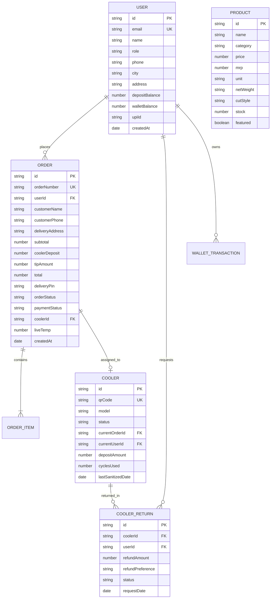

# GoMeat - Database Schema & Data Dictionary

**Official Project:** GoMeat  
**Database Engines:** MongoDB Atlas (Mongoose ODM) & Persistent Document Store Fallback  
**Standard Character Encoding:** UTF-8  
**Last Updated:** November 9, 2026

---

## 1. Entity-Relationship Overview

---

## 2. Detailed Collection Schemas

### 2.1 Users (`users`)
Stores customer accounts, operations administrators, and delivery partner profiles.

| Field | Type | Description | Index / Constraints |
|:---|:---|:---|:---|
| `_id` | ObjectId | MongoDB Primary Key | Unique, Auto-generated |
| `id` | String | Application-level User ID (`usr_...` or UUID) | Unique |
| `name` | String | Full name of the user | Required |
| `email` | String | Contact email address | Unique, Lowercase |
| `phone` | String | Mobile phone number (`+91 9XXXX XXXXX`) | Indexed |
| `password` | String | Salted bcrypt password hash | Min length 6 |
| `role` | String | Access role: `customer` \| `admin` \| `rider` | Default `customer` |
| `city` | String | Service city (e.g., `Bengaluru`, `Mumbai`) | Default `Bengaluru` |
| `address` | String | Default delivery address | Optional |
| `depositBalance` | Number | Total active ₹250 cooler deposits held | Default `0` |
| `walletBalance` | Number | Store credit balance in GoMeat Wallet | Default `0` |
| `walletTransactions` | Array | Log of debits, credits, and deposit refunds | Embedded documents |
| `upiId` | String | Preferred UPI ID for instant deposit refunds | e.g. `customer@okhdfcbank` |
| `createdAt` | Date | Account creation timestamp | ISO 8601 |

---

### 2.2 Products (`products`)
Stores daily fresh harbor catches, pasture-grazed meats, and chef-marinated items.

| Field | Type | Description | Examples / Constraints |
|:---|:---|:---|:---|
| `id` | String | Unique product SKU code | `prod_1`, `prod_curry_cut` |
| `name` | String | Display name of the cut | "Seer Fish Steaks", "Tender Goat" |
| `category` | String | Food category | `Fish & Seafood`, `Fresh Chicken`, `Tender Mutton`, `Ready to Cook` |
| `price` | Number | Selling price in INR (₹) | Required |
| `mrp` | Number | Maximum retail price (MRP) in INR | Used for strikethrough savings |
| `unit` | String | Unit packaging size | `500g`, `350g`, `1kg` |
| `netWeight` | String | Guaranteed cleaned net meat weight | `450g net`, `300g net` |
| `cutStyle` | String | Butchery cut style | `Curry Cut`, `Steaks`, `Biryani Cut` |
| `chillingMethod` | String | Cold-chain chilling spec | `0°C to 4°C FreshSeal™ Cold Chain` |
| `stock` | Number | Available inventory count | Real-time decrement on checkout |
| `imageUrl` | String | High-resolution cut photo | `/images/products/prod_1.jpg` |
| `featured` | Boolean | Highlight on storefront | Default `false` |

---

### 2.3 Orders (`orders`)
Central order record storing items, pricing breakdowns, IoT temperatures, and the 4-digit verification PIN.

| Field | Type | Description | Constraints |
|:---|:---|:---|:---|
| `id` | String | Order identifier | e.g., `ORD-84920` or `GOM-102931` |
| `orderNumber` | String | Formatted order tracking number | Unique |
| `userId` | String | ID of ordering customer | Foreign key to `users` |
| `customerName` | String | Customer full name | Snapshot on checkout |
| `customerEmail` | String | Customer email address | Notification recipient |
| `customerPhone` | String | Customer contact number | Delivery partner communication |
| `deliveryAddress` | String | Full delivery address with PIN code | Snapshot on checkout |
| `items` | Array | Purchased items with quantity and price | Non-empty array |
| `subtotal` | Number | Raw items subtotal in INR | Calculated |
| `discountAmount` | Number | Discount from applied promo code | Default `0` |
| `couponCode` | String | Promo coupon applied (`FREEDEL`, etc.) | Optional |
| `coolerDeposit` | Number | Reusable cold box deposit | Fixed `₹250` |
| `shippingFee` | Number | Shipping charge (₹0 above ₹499) | `0` or `40` |
| `tipAmount` | Number | Delivery partner tip | `0`, `20`, `30`, `50` |
| `total` | Number | Net total charged to customer | Required |
| `deliveryPin` | String | Unique 4-digit verification PIN | Random `1000–9999` per order |
| `orderStatus` | String | Lifecycle status | `CONFIRMED` -> `PREPARING` -> `QUALITY_CHECK` -> `PACKED` -> `OUT_FOR_DELIVERY` -> `DELIVERED` |
| `paymentStatus` | String | Payment outcome | `PENDING`, `PAID`, `FAILED`, `REFUNDED` |
| `coolerId` | String | Assigned ThermalVault box | e.g., `BOX-BLR-102` |
| `liveTemp` | Number | Current internal box temperature | Safe threshold `0.0°C–4.0°C` |
| `deliveryExecutive` | String | Assigned rider name and phone | Displayed to customer |
| `createdAt` | Date | Timestamp of order creation | ISO 8601 |

---

### 2.4 Coolers (`coolers`)
Fleet inventory tracking each reusable ThermalVault™ cold box throughout its multi-year circular lifecycle.

| Field | Type | Description | Values / States |
|:---|:---|:---|:---|
| `id` | String | Unique cold box asset code | `BOX-BLR-101` |
| `qrCode` | String | Scannable physical barcode | `GOMEAT-BOX-101` |
| `model` | String | Insulated container model | `ThermalVault 18L - Reusable EPP Cold-Gel Box` |
| `status` | String | Fleet state | `available`, `assigned`, `with_customer`, `return_requested`, `sanitizing` |
| `currentOrderId` | String | Linked active order ID | Nullable |
| `currentUserId` | String | Customer possessing the box | Nullable |
| `depositAmount` | Number | Required refundable deposit | Default `250` |
| `cyclesUsed` | Number | Lifetime trip count | Increment on return & wash |
| `lastSanitizedDate`| String | Date of last UV & sanitization wash | YYYY-MM-DD |
| `assignedHub` | String | Regional distribution depot | e.g., `Bengaluru Regional Hub Depot` |

---

### 2.5 Cooler Returns (`coolerReturns`)
Doorstep pickup requests and deposit refund verifications for returned cold boxes.

| Field | Type | Description | Values / States |
|:---|:---|:---|:---|
| `id` | String | Unique return request identifier | e.g., `RET-702` |
| `coolerId` | String | Cold box barcode being returned | Foreign key to `coolers` |
| `userId` | String | Requesting customer account | Foreign key to `users` |
| `refundAmount` | Number | Amount to refund | Default `250` |
| `refundPreference`| String | Customer preference | `wallet` (instant credit) or `upi` (bank transfer) |
| `status` | String | Pickup progression | `pickup_requested`, `picked_up`, `refunded`, `rejected` |
| `conditionNotes` | String | Quality check notes on intake | e.g., "EPP foam intact, gel packs clean" |
| `scheduledPickupSlot`| String| Scheduled time window | e.g. "Tomorrow Morning, 7:00 AM - 10:00 AM" |
| `requestDate` | Date | Timestamp of return booking | ISO 8601 |
| `completedAt` | Date | Timestamp of refund execution | ISO 8601 |
