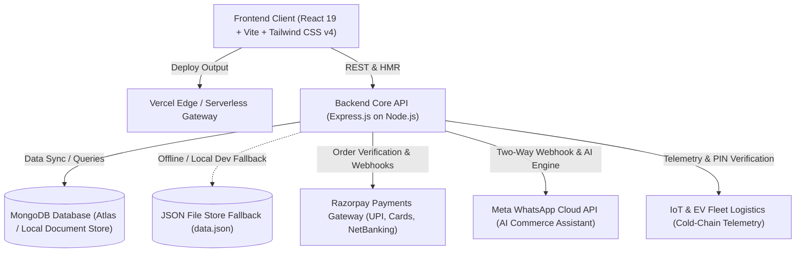

# GoMeat - Technical Architecture & System Design

**Official Project Name:** GoMeat  
**Tagline:** Fresh Quality. Delivered with Care.  
**Architecture Model:** Clean Full-Stack Monorepo (React 19 + Express 4 + MongoDB / In-Memory JSON Store)  
**Last Updated:** November 9, 2026

---

## 1. High-Level Architectural Overview

GoMeat is a direct-to-consumer (D2C) fresh meat, poultry, and coastal seafood platform with proprietary **Circular Reusable Cold-Box Logistics (ThermalVault™)** and **0°C–4°C Blast-Chilled Cold Chain Assurance**.



---

## 2. Monorepo Directory Organization

The codebase is organized into clean, self-contained packages:

```
GoMeat/
├── frontend/                     # React 19 Client SPA
│   ├── public/                   # Static assets, favicon, product cuts
│   ├── src/
│   │   ├── components/           # Reusable UI & Layout Components
│   │   │   ├── AuthModal.tsx
│   │   │   ├── CartDrawer.tsx
│   │   │   ├── CategorySection.tsx
│   │   │   ├── CheckoutModal.tsx
│   │   │   ├── FloatingBottomCartBar.tsx
│   │   │   ├── GlassmorphicLoginGate.tsx
│   │   │   ├── GoogleSignInButton.tsx
│   │   │   ├── HeroSection.tsx
│   │   │   ├── LocationSelectorModal.tsx
│   │   │   ├── Navbar.tsx
│   │   │   ├── OrderConfirmationModal.tsx
│   │   │   ├── ProductDetailModal.tsx
│   │   │   ├── WhatsAppButton.tsx
│   │   │   └── WhatsAppChatbotModal.tsx
│   │   ├── pages/                # Top-level application views
│   │   │   ├── CatalogPage.tsx
│   │   │   ├── CustomerDashboardPage.tsx
│   │   │   ├── AdminDashboardPage.tsx
│   │   │   ├── OrderTrackingPage.tsx
│   │   │   └── CoolerReturnsPage.tsx
│   │   ├── context/              # Global state providers (Auth, Cart)
│   │   ├── utils/                # Invoices, PIN helpers, formatters
│   │   ├── api.ts                # Unified REST API client
│   │   └── types.ts              # Strict TypeScript domain interfaces
│   ├── package.json
│   └── vite.config.ts
│
├── backend/                      # Express.js REST API
│   ├── models/                   # Mongoose schemas (Order, User, Product, Cooler)
│   ├── routes/                   # Route controllers
│   │   ├── payments.js           # Razorpay, Wallet & Cash on Delivery engine
│   │   ├── googleAuth.js         # Cryptographic Google token verification
│   │   └── whatsappWebhook.js    # Meta WhatsApp Webhook handler
│   ├── services/                 # AI chatbot & background business logic
│   ├── db.js                     # Unified dual-layer database abstraction
│   ├── mongo.js                  # Resilient MongoDB connector
│   ├── data.json                 # Persistent local JSON data store
│   ├── package.json
│   └── server.js                 # API server entrypoint
│
├── docs/                         # Technical documentation & architecture guides
│   ├── BRANDING_AUDIT.md
│   ├── PROJECT_ARCHITECTURE.md
│   ├── DATABASE_SCHEMA.md
│   ├── API_DOCUMENTATION.md
│   ├── DEVELOPMENT_GUIDE.md
│   ├── REBRANDING_REPORT.md
│   └── presentations/            # Engineering & business decks
│
├── scripts/                      # Testing, automation & developer tools
│   ├── start-dev.js              # One-command dual dev environment starter
│   ├── test-workflows.js         # End-to-end integration test suite
│   └── test-mongodb.js           # Database connectivity diagnostic tool
│
├── api/                          # Vercel Serverless Function entrypoint
│   └── index.js
├── .env.example                  # Sanitized environment template
├── .editorconfig                 # Uniform cross-platform editor config
├── .gitattributes                # Consistent line-ending normalization
├── .gitignore                    # Professional monorepo ignore definitions
├── package.json                  # Root monorepo orchestration
├── README.md                     # Production repository README
└── GoMeat.code-workspace         # VS Code multi-root workspace file
```

---

## 3. Core Architectural Subsystems

### 3.1 Authentication & Security
- **JWT Authentication:** Stateful user session tokens signed with `JWT_SECRET` (`gomeat-cuts-india-secret-2026`).
- **Google OAuth 2.0:** Verified server-side via `google-auth-library` `OAuth2Client.verifyIdToken`.
- **Role-Based Access Control (RBAC):** Middleware checks `customer` vs. `admin` roles on sensitive administrative routes.
- **Backward Token Compatibility:** Dual-token lookup (`gomeat_token` with fallback to `frost_token`) ensures zero session invalidation during migration.

### 3.2 Dual-Layer Database Architecture
- **Layer 1 (Production):** MongoDB Atlas via Mongoose ODM models with automatic schema casting and timestamps.
- **Layer 2 (Zero-Config Development):** File-backed JSON store (`data.json`) with in-memory caching and disk synchronization.
- **Dynamic Synchronization:** On boot, `db.syncWithMongo()` hydrates local state with live cloud data.

### 3.3 Circular Reusable Cold Chain (ThermalVault™)
- **₹250 Refundable Deposit:** Tracked per cooler in custody (`BOX-BLR-XXX`).
- **Dynamic Handover PIN:** Unique 4-digit code generated per order and customer (`getOrderDeliveryPin`) for rider identity verification.
- **Live IoT Cold-Chain Monitoring:** Orders record live temperature (`0.8°C–2.3°C`) throughout 6 timeline stages.
- **1-Click UPI & Wallet Refunds:** Once the box is inspected, ₹250 is instantly credited back to GoMeat Wallet or customer UPI.

### 3.4 Conversational AI Commerce
- **Meta WhatsApp Webhook:** Handles customer incoming messages via WhatsApp Cloud API.
- **Natural Language Engine (`aiChatbot.js`):** Recognizes butchery preferences (Biryani cuts, curry cuts), live inventory inquiries, and box return requests.
